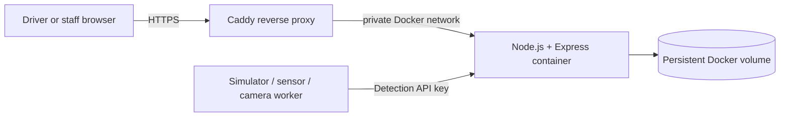
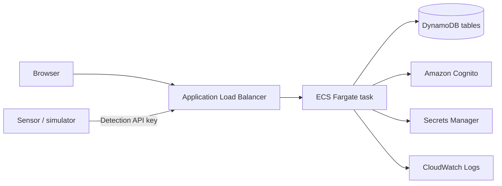

# SmartPark — Cloud Smart Parking

SmartPark is a parking occupancy and reservation app. Drivers can view bay availability, create and manage reservations, and facility staff can manage bays and inspect detection activity. Occupancy can be supplied by a simulator, an IoT sensor, or an optional camera detector.

The repository supports two deployment paths. The live preview currently runs as Docker containers on an existing EC2 host with local persistent storage. An ECS Fargate, Cognito, and DynamoDB stack is also included for accounts where those AWS resources are available.

## What it does

- Shows parking bays as **available**, **occupied**, **reserved**, or **unverified**.
- Creates reservations for available bays and prevents a bay from being reserved twice.
- Lets a driver cancel or delete their own reservation. Deleting an active reservation first cancels it and releases the space; the detection audit event remains.
- Validates Indian vehicle registration numbers on the form and API, including Bharat-series registrations.
- Provides a separate staff sign-in choice and a facility console for staff accounts assigned the administrator role.
- Accepts occupancy updates from the Node simulator, a virtual sensor, ESP32 examples, and an optional CPU-only OpenCV camera worker.

## Technology stack

| Area | Technologies |
|---|---|
| Web UI | HTML, CSS, vanilla JavaScript; same-origin REST calls |
| API | Node.js 24, Express 4, JSON REST endpoints |
| Authentication | bcryptjs password hashes and signed HTTP-only cookies in single-host mode; Amazon Cognito in the Fargate configuration |
| Data | Persistent local JSON store for the current single-host preview; Amazon DynamoDB for the Fargate configuration |
| AWS | ECS Fargate, ECR, ALB, IAM, Cognito, DynamoDB, Secrets Manager, CloudWatch in the optional managed stack; IoT Core instructions for sensor telemetry |
| Containers and TLS | Docker, Docker Compose, Caddy 2.10; Caddy obtains and renews public certificates for configured hostnames |
| Detection | Node.js simulator and virtual sensor; Python 3.12, OpenCV headless, NumPy, Requests for the optional CPU camera worker |

The camera image does not install PyTorch, CUDA, GPU runtimes, or GUI libraries.

## Architecture

### Current single-host preview



The live preview uses a Docker Compose app and Caddy on an existing EC2 host. The Node app uses `DB_MODE=local` and `AUTH_MODE=local`, with data stored in a Docker volume. This is a single-host setup; it is not the DynamoDB/Cognito stack. Details and operations are in [`aws/ec2-deployment.md`](aws/ec2-deployment.md).

### Optional managed AWS stack



The CloudFormation template and deployment guide are in [`aws/fargate-app.yml`](aws/fargate-app.yml) and [`aws/fargate-deployment.md`](aws/fargate-deployment.md). This path needs AWS credentials and permission to create the listed resources.

## Run locally

### Docker Compose

Requirements: Docker Engine with the Compose plugin.

```bash
export LOCAL_SESSION_SECRET="$(openssl rand -hex 32)"
export DETECTION_API_KEY="$(openssl rand -hex 32)"
# Optional: one or more staff emails, comma-separated.
export LOCAL_ADMIN_EMAILS="staff@example.com,manager@example.com"
docker compose up --build
```

Open [http://localhost:5000](http://localhost:5000). Create a driver account from **Sign in**. Staff sign in using **Facility staff**; selecting the staff role does not grant access by itself. The email must be listed in `LOCAL_ADMIN_EMAILS`.

The Compose volume persists local data across container restarts. To reset local demo data, remove the `app-data` volume deliberately with `docker compose down -v`.

### Run the API directly

```bash
cd backend
cp .env.example .env
npm ci
npm start
```

Set a strong, private `LOCAL_SESSION_SECRET` in `backend/.env` before using local accounts. Add any local staff email addresses to `LOCAL_ADMIN_EMAILS`. Do not commit `.env` files, passwords, AWS credentials, or API keys.

## Detection inputs

The API accepts trusted occupancy updates at `POST /api/detection/update` using the `x-detection-key` header. Set `PARKING_API_URL` and `DETECTION_API_KEY` in each publisher's environment; never put the key in frontend code or commit it.

- Run one simulator cycle: `node detection/simulator/simulator.js --once`
- Run the continuous simulator: `node detection/simulator/simulator.js`
- Virtual sensor instructions: [`detection/sensor/README.md`](detection/sensor/README.md)
- CCTV detector and CPU container: [`detection/cctv/README.md`](detection/cctv/README.md)
- AWS IoT Core setup: [`aws/iot-core-setup.md`](aws/iot-core-setup.md)

## API overview

- `GET /api/health` — service and storage health
- `POST /api/auth/signup`, `POST /api/auth/login`, `POST /api/auth/logout`, `GET /api/auth/me` — account sessions
- `GET /api/parking/slots`, `GET /api/parking/availability` — public bay status
- `GET/POST /api/bookings`, `PUT /api/bookings/:id/cancel`, `DELETE /api/bookings/:id` — authenticated, owner-scoped reservations
- `GET /api/admin/dashboard` and `/api/admin/slots` — administrator-only facility management
- `POST /api/detection/update` — publisher-key-protected occupancy ingestion

## Repository map

```text
backend/                 Express API, auth, data adapters, services, and API checks
frontend/                Public pages, booking flow, staff login, and admin console
detection/simulator/     Node.js occupancy simulator
detection/sensor/        Virtual sensor and ESP32 example

detection/cctv/          CPU-only OpenCV sample detector and container
aws/                     AWS templates, setup, and deployment guides
Dockerfile               Node app image
Caddyfile                Reverse proxy, TLS, and hostname routing
docker-compose.yml        Local development stack
docker-compose.ec2.yml    Existing-host deployment stack
```

## Deployment and current hostname

- Existing EC2 Compose deployment: [`aws/ec2-deployment.md`](aws/ec2-deployment.md)
- ECS Fargate deployment: [`aws/fargate-deployment.md`](aws/fargate-deployment.md)
- DynamoDB table design: [`aws/dynamodb-schema.md`](aws/dynamodb-schema.md)

The current preview hostname is IP-mapped DNS. Replace it with a domain you control for a clean branded URL; the domain's DNS must point to the host, and Caddy must be configured for that hostname before the old address can be removed. See the EC2 guide for the current host and TLS setup.

## Security notes

- The admin HTML route and admin API both verify the signed-in account's staff role on the server.
- Drivers can access only their own bookings, including delete and cancel operations.
- Authentication cookies are HTTP-only, same-site, and Secure in production.
- Detection publishing keys are server-side secrets, not browser credentials.
- The current single-host data volume needs backups and should run as one app replica. Use the Fargate/DynamoDB deployment for managed multi-service persistence when the AWS account permits it.
