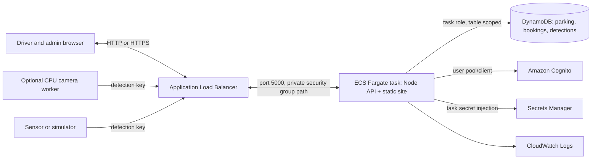

# Smart Parking AWS Architecture

The recommended deployment packages the Express API and static frontend into a Docker image and runs it on Amazon ECS Fargate. Fargate manages the compute; this project does not create or manage EC2 instances. See [the Fargate deployment guide](fargate-deployment.md) and [CloudFormation template](fargate-app.yml).

The application stack creates the VPC, two public subnets in separate Availability Zones, load balancer, ECS cluster/service, Cognito user pool and admin group, three DynamoDB tables, a generated detection API key, and CloudWatch log group. The task role is limited to the app tables. The ECS execution role can pull images, write logs, and inject the detection secret. The task security group only accepts port 5000 from the ALB. Tasks use public IPv4 egress to reach AWS service endpoints without NAT gateways; they have no inbound public rule and there is no SSH path.

## Data and identity

- Cognito owns user registration and login. The backend verifies signed Cognito access tokens and stores them in HTTP-only, same-site cookies.
- Booking records derive their owner from the verified session. A driver can only list, view, and cancel their own reservations.
- Admin routes require membership in the `parking-admin` Cognito group.
- Detection publishers use a separate random key stored by Secrets Manager and injected into the task at runtime.
- DynamoDB uses on-demand billing and point-in-time recovery. Table names include the CloudFormation stack name; required secondary index names are defined in the template.
- `ParkingSlots` conditional writes prevent two requests from reserving a bay at the same time.

## TLS and domain

The stack can run temporarily behind the ALB's HTTP URL while the site is being reviewed. Production signup and login reject HTTP. For account use, configure DNS and pass a DNS-validated ACM certificate ARN from the same region; the template then enables HTTPS and redirects port 80 to 443. A public IP address alone cannot receive a normally trusted public TLS certificate.

## Camera workload

The computer vision example is an optional, separate CPU worker. Its image uses `opencv-python-headless`, NumPy, and Requests. It does not install PyTorch, CUDA, or GPU runtime packages. Real-time camera processing should generally run near the camera and publish only occupancy updates to the API.
